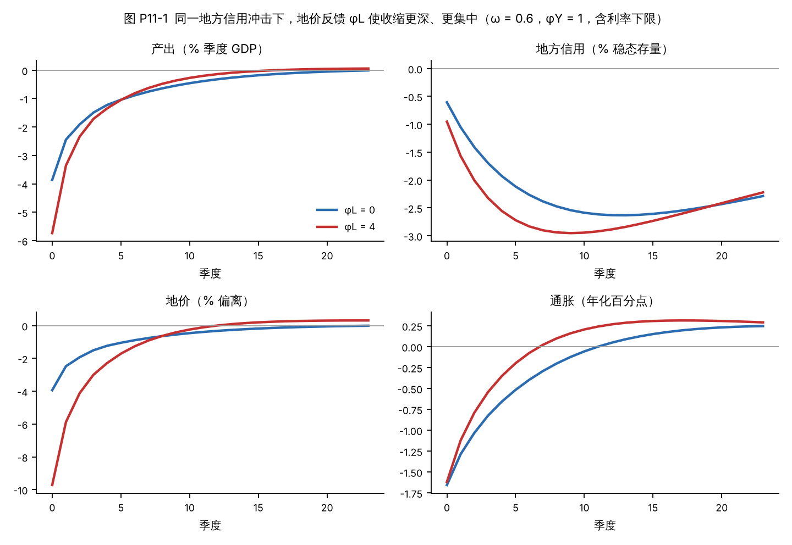
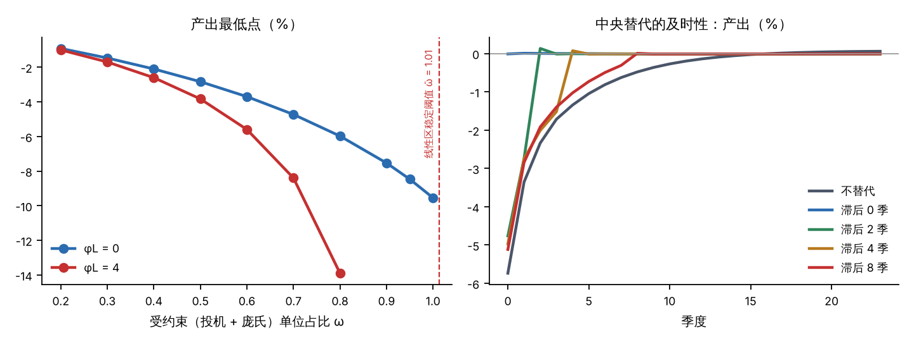
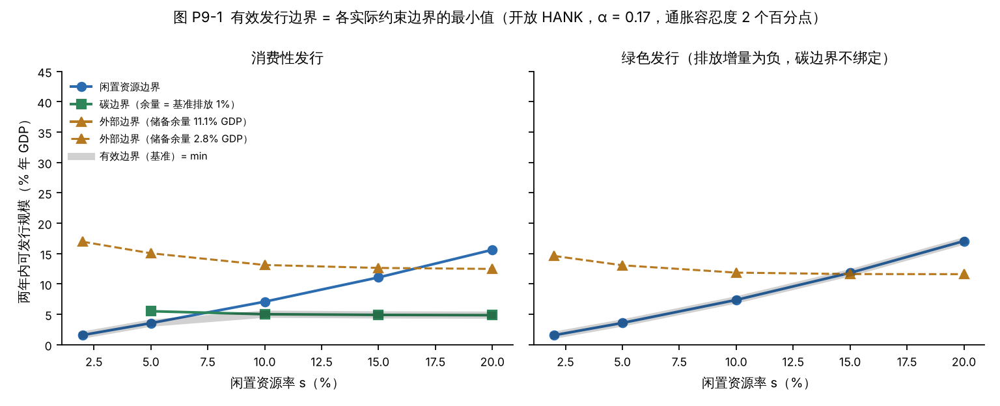
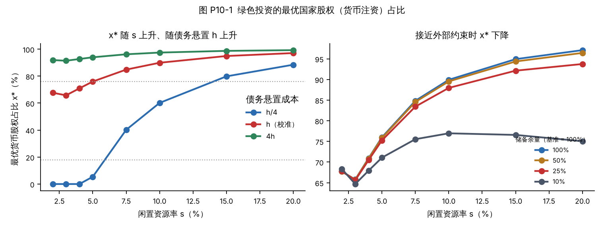

工作稿 v0.2 · 2026-11-01 · 在 v0.1（2026-10-26）基础上增补，**v0.1 原文一字未改**；本文件只处理 v0.1 第 6.2 节标 ⚠ 的三个待证命题 P9—P11。

> 这份文件做三件事：（1）给 P9、P10、P11 写出可以进正文的解析证明，并把 v0.1 的命题表述按证明结果收紧；（2）在一个与 v0.1 记号一致的精简版模型 U 上做 HANK 数值实验，逐一核对解析结论；（3）更新命题地图和参数—模块开关表。
>
> 记号沿用 v0.1：$N=B+R-S$、$D=N+L+S$、$s$、$\nu$、$\kappa_p$、$\zeta$、$fx$、$\varphi_L$、$\varphi_Y$、$\mathcal M_j$、$m_j$、$\bar X$ 等。v0.2 新增的记号在首次出现时定义，并汇总在附录 A。
>
> **重要说明（关于代码）**：03、04、05 文件夹的代码不在本次工作的环境里，所以 v0.2 的数值不是在 `hank_hyst.py` 上加模块得到的，而是用一套**重新实现**的精简模型 U（`code/ncsrr/`，约 600 行 Python）算出来的。家庭块、菲利普斯曲线、地方抵押约束、国家部门预算约束与 03 的设定相同，参数取 v0.1 附录 A 的校准值。因此数值与 03—05 **不会逐位相同**，但可以对照：在完全独立的实现下，封闭经济的闲置资源边界与闲置率之比为 0.56—0.64（第 1.3 节），与 v0.1 引用的 03 实验 2"边界 ≈ 0.55 × 闲置率"基本一致。把这些模块移植进 05 的代码、并做"新参数取零时逐位复现"的检查，列为下一步（第 6 节）。
>
> 标 ⚠ 的是仍未解决、或依赖情景参数的内容。

---

## 0. 一页纸摘要

| 命题 | v0.1 状态 | v0.2 结果 | 一句话结论 | 数值要点（精简模型 U） |
|---|---|---|---|---|
| **P11** Minsky 式地方信用周期 | ⚠ 待证 | **已证明**（解析 + HANK） | 地价反馈把同一冲击放大 $1/(1-a)$ 倍，$a=(1-\rho_c)\,\omega\,[\varphi_L+\varphi_Y\mathcal M_0(1-\gamma_0)\bar L]$；庞氏/投机占比 $\omega$ 超过阈值 $\bar\omega$ 时没有有界均衡；中央同期替代切断产出环节 | $\varphi_L$ 从 0 到 6，产出最低点从 −3.7% 到 −7.6%；$\bar\omega$ 的 HANK 数值与解析式相差不到 2%；同期替代使 5 年累计产出损失从 4.5% 降到 0.04% GDP，拖延 4 个季度则为 2.8% |
| **P9** 多重实际约束 | ⚠ 待证 | **已证明，表述收紧** | 有效边界 = 各约束边界的最小值（单调性下的一般结果）；绿色发行的边界更高，**条件**是减排足够强、且外部约束不绑定 | 消费性发行在 $s\ge10\%$ 时被碳约束卡在约 5% GDP；绿色发行不受碳约束，$s=20\%$ 时边界为 17.1% GDP（消费性为 4.9%）；但绿色发行的外部约束占用高约 10% |
| **P10** 发行结构 | ⚠ 待证 | **已证明（闭式解），数值部分成立** | $x^*=\mathrm{clip}[(h-A)/(h+B)]$；$x^*$ 随 $h$ 上升；接近任一 $b_k>0$ 的约束时 $x^*$ 下降；随 $s$ 上升的**充分条件**是 $a_\pi b_\pi$ 随 $\kappa(s)$ 上升 | M 体制下货币与项目债的需求差别很小（$b_\pi/a_\pi$ 为 1%—7%）；$s\ge3\%$ 时 $x^*$ 随 $s$ 单调上升，$s\le3\%$ 时出现非单调 |

**对 v0.1 命题表述的三处收紧**（建议写进博士论文第 7、9 章）：

1. **P11** 加一句："Minsky 反馈改变的是收缩的**时间集中度**，不改变累计的信用损失（信用—年）"（引理 11.3）。收缩更深、更快，是因为同样多的去杠杆被挤进了更短的时间。累计产出损失的差别只来自一般均衡的动态和非线性，在模型 U 中较小（4.05% → 4.62% GDP）。
2. **P9** 的"绿色发行的有效边界高于等额的消费性发行"需要加两个条件：(i) 减排效应 $\psi_\sigma$ 足够强，使绿色发行的累计排放增量为负或足够小；只有产能效应、没有减排效应的绿色投资会**增加**排放，边界反而更低（第 3.4 节）。(ii) 外部约束不绑定，或者绿色投资的进口含量足够低（$\alpha_g$ 足够小）。产能效应压低通胀，央行因此加息更少，私人吸收与进口都更多，所以同样的发行规模下，绿色发行消耗的储备反而更多。
3. **P10** 的"随闲置资源率上升而上升"在线性模型里无条件成立。在非线性 HANK 中，它要求"项目债融资的基准通胀 × 货币融资的额外通胀"随 $\kappa(s)$ 上升。在 $s\le3\%$ 的极端紧张区间，这个条件不成立：两种融资方式的通胀差别反而缩小。原因是此时通胀峰值几乎完全由支出本身决定，而这部分支出与融资方式无关。

---

## 1. 数值工具：精简版模型 U

### 1.1 模块与 v0.1 的对应

| v0.1 模块 | 精简模型 U 中的实现 | 开关/参数 |
|---|---|---|
| 3.1 家庭 | 一资产 HANK，EGM 稳态 + fake-news 序列空间雅可比；手停口停占比 $\mu=0.25$；家庭存款 = E3 = 152% 年 GDP | `mu`, `D` |
| 3.3 企业 | 非线性闲置资源菲利普斯曲线 $\ln mc_t=-\nu[\ln(1-u_t)-\ln(1-\bar u)]$，$\pi_t=\kappa_p\ln mc_t+\beta\pi_{t+1}$；产能 $\ln K_t=h_t+\theta_g K^g_{t-1}/K^{pub}$，$h_t=\rho_k h_{t-1}+\zeta(u_{t-1}-\bar u)$ | `s`, `nu`, `kappa_p`, `zeta`, `theta_g` |
| 3.4 地方 | 抵押约束 + Minsky 地价方程；受约束单位占比 $\omega$；地方支出 $=$ 信用流量 + 中央转移 − 利息（$m_\ell=1$） | `rho_c`, `phi_L`, `phi_Y`, `omega`, `lam_r` |
| 3.5 国家部门 | 合并预算约束，税收规则 $T^c_t=\phi_B M_{t-1}$；中央替代规则 $TR_t=-\gamma\,\Delta L_t\cdot\mathbb 1\{t\ge d\}$；泰勒规则（可选利率下限） | `phi_B`, `gamma`, `d`, `phi_pi`, `elb_room` |
| 3.6 国外 | 资本管制下的钉住，国际收支由储备吸收（v0.1 3.6 的第二种设定）；进口 $=\alpha(C+G)+\alpha_g I^g$ | `alpha`, `alpha_g` |
| 3.7 绿色与碳 | $E^m_t=\sigma(K^g_t)Y_t$，$\sigma=\bar\sigma e^{-\psi_\sigma K^g}$；绿色基金投资 $I^g$ 以货币股权 $x$、项目债 $1-x$ 融资，项目债由使用者付费在 $N_d$ 季内摊还 | `psi_sigma`, `x`, `Nd`, `e_g` |

求解方法与 v0.1 第 3.8 节相同：用序列空间（$T=300$ 季）求完全预见路径。菲利普斯曲线保留非线性，用拟牛顿法加回溯线搜索求解，其余各块是线性的。

### 1.2 校准（季度，稳态季度 GDP = 1）

| 参数 | 值 | 来源 |
|---|---|---|
| $\bar r$ | 1.5%/年 | v0.1 7.3 |
| $D,\ L,\ M=D-L$ | 152%、97%、55% 年 GDP | v0.1 附录 A（E3、地方信用、E1） |
| $\mu$；EIS；收入过程 | 0.25；0.5；$\rho_e=0.966$，$\sigma_e=0.5$，7 点 | 03 的常用设定；$\beta=0.99607$ 由资产市场出清校准 |
| $\kappa_p,\ \nu$ | 0.085、0.02 | v0.1 附录 A；$\kappa(5\%)=0.0323$，与附录 A 一致 |
| $\phi_\pi,\ \phi_B$ | 1.5、0.02 | v0.1 附录 A |
| $\rho_c$ | 0.9 | v0.1 附录 A |
| $\alpha$；储备、下限 | 0.17；16.1%、5% 年 GDP | v0.1 附录 A（04） |
| $I,\ G^c,\ G^\ell$ | 0.40、0.08、0.12 | 稳态支出结构（⚠ 近似） |
| $\theta_g$；$K^{pub}$ | 0.08；2.5 倍年 GDP | 公共资本的产出弹性（Bom and Ligthart 2014 的元分析均值）；⚠ |
| $\psi_\sigma$ | 0.2（每单位季度 GDP 的绿色资本） | 使"每年 5% GDP 的绿色投资使排放强度年降约 4%"，与中国近年碳强度降幅同量级；⚠ |
| $\delta_g$ | 2%/季 | ⚠ |
| $N_d$ | 40 季 | 项目债 10 年摊还；⚠ |

### 1.3 三项检查

1. **存量—流量一致**（v0.1 7.3 的检查 1）：每次求解后检查家庭存款是否满足 $A^h_t=M_t+L_t+D^g_t$。全部实验中最大残差为 $3\times10^{-9}$（季度 GDP 单位），与 05 `sfc_check.py` 的 $10^{-10}$ 量级相当。
2. **家庭雅可比**：fake-news 算法得到的雅可比与逐期蛮力模拟逐列比较，最大误差为 $2\times10^{-6}$。
3. **与 03 实验 2 的交叉验证**：封闭经济（$\alpha=0$）下，消费性发行在 8 个季度内花出、通胀峰值上升 2 个百分点所对应的规模如下。π̄ 取 2 个百分点是事先定好的，没有为匹配 03 去调整。

| $s$ | 2% | 5% | 10% | 15% | 20% |
|---|---|---|---|---|---|
| 边界（% 年 GDP） | 1.28 | 2.87 | 5.63 | 8.77 | 12.34 |
| 边界 / $s$ | 0.64 | 0.57 | 0.56 | 0.58 | 0.62 |

比例系数 0.56—0.64 与 03 的 0.55 基本一致。两端偏高有两个原因：在 $s$ 很小时，$\kappa(s)$ 的非线性起作用；在 $s$ 很大时，多余产能使乘数接近其上限。这个结果说明 v0.1 的解析式 R2 不依赖某一套代码。

### 1.4 与 v0.1 设定的差异（需要在移植到 05 代码时处理）

1. **地方支出**：取 $m_\ell=1$（信用流量当期全部花出），没有 v0.1 3.4 的现金缓冲 $F$。这会使 P11 的放大效应偏大；有缓冲时 $\mathcal M_0$ 变小，阈值 $\bar\omega$ 随之上升（见引理 11.2 的公式）。
2. **地方债的事后实际利率**：参数 $\lambda_r$ 表示其中当季进入地方支出的比例，基准取 0（城投债以固定利率为主，并靠展期、置换平滑），其余部分由银行利润吸收并归家庭。$\lambda_r=1$ 对应完全的费雪债务通缩渠道，作为稳健性检验报告（第 2.4 节）。
3. **开放模块**：采用钉住汇率，没有 04 的利率平价、风险溢价和企业外币债。因此每单位发行消耗的储备 $\lambda_{imp}$ 为 16%—23%，低于 04 O1 的约 32%（第 3.4 节）。
4. **投资**：投资外生，没有 v0.1 3.3 的加速数项 $\psi_I$。
5. **绿色资本进入产能的方式**：直接以产出弹性 $\theta_g$ 进入产能，不经过 $\rho_k$ 的累积，与 v0.1 3.3 的写法不同（v0.1 把 $\psi_g\hat K^g$ 放在 AR(1) 递推里）。两种写法的长期效应可以通过 $\psi_g=(1-\rho_k)\theta_g/K^{pub}$ 对应起来。

---

## 2. P11 Minsky 式地方信用周期

### 2.1 命题（v0.2 表述）

> **P11** 在 v0.1 3.4 节的地价方程 $q_t=\varphi_L\Delta\ln L_t+\varphi_Y\hat y_t+\varepsilon^q_t$ 下：
>
> (i) **放大**：同一外生冲击引起的地方信用收缩峰值、单季信用净减少和产出下降，近似按 $1/(1-a)$ 放大，其中
> $$a=(1-\rho_c)\,\omega\,\Phi,\qquad \Phi=\varphi_L+\varphi_Y\,\mathcal M_0\,(1-\gamma_0)\,\bar L.$$
> $a$ 随地价反馈 $\varphi_L$、$\varphi_Y$ 和受约束（投机 + 庞氏）单位的信用占比 $\omega$ 上升，随中央的同期替代比例 $\gamma_0$ 下降。
>
> (ii) **"稳定孕育不稳定"**：存在阈值 $\bar\omega=(1+\rho_c)/[2(1-\rho_c)\Phi]$。$\omega\ge\bar\omega$ 时地方信用系统没有有界均衡（Minsky 时刻）。长期平稳会让 $\omega$ 逐步上升（对冲单位逐步转为投机、庞氏单位），系统因此会自己走到阈值附近。
>
> (iii) **替代的及时性**：中央以国家股权同期替代（$\gamma_0=1$）可以切断"信用 → 产出 → 地价"这一环。替代越晚，累计产出损失越大；有产能内生（$\zeta>0$）时，这部分损失会变成永久的产能损失。
>
> (iv) **不变量**：在线性近似下，累计信用损失 $\sum_t \ln(L_t/\bar L)$ 与 $\varphi_L$、$\varphi_Y$ 无关。Minsky 反馈改变的是收缩的时间分布，而不是总量。

### 2.2 解析证明

**设定**（约化形式，所有变量为对稳态的对数偏离）。把地方融资单位按 Minsky 的三分法分开：对冲单位用经营现金流还本付息，它们的借款不受抵押品约束，令 $\ell^H_t=0$；投机与庞氏单位（信用占比 $\omega$）需要滚动或新增借款，受 v0.1 3.4 的抵押约束：

$$\ell^C_t=\rho_c\,\ell^C_{t-1}+(1-\rho_c)\,(q_t+\varepsilon_t),\qquad \ell_t=\omega\,\ell^C_t.\tag{11.1}$$

地价方程（v0.1 3.4）：$q_t=\varphi_L\,\Delta\ell_t+\varphi_Y\,y_t$。产出用跨期凯恩斯交叉的当期近似：地方支出等于信用流量（$m_\ell=1$），中央同期替代比例为 $\gamma_0$，于是

$$y_t=\mathcal M_0\,(1-\gamma_0)\,\bar L\,\Delta\ell_t,\tag{11.2}$$

其中 $\mathcal M_0$ 是地方支出的当期乘数，$\bar L$ 是以季度 GDP 计的地方信用存量。代入后得到

$$q_t=\Phi\,\omega\,\Delta\ell^C_t\quad\Longrightarrow\quad (1-a)\,\ell^C_t=(\rho_c-a)\,\ell^C_{t-1}+(1-\rho_c)\,\varepsilon_t.\tag{11.3}$$

**引理 11.1（放大）**：设 $a<1$。冲击当期 $\partial\ell_0/\partial\varepsilon_0=\omega(1-\rho_c)/(1-a)$，产出的当期反应为 $\mathcal M_0(1-\gamma_0)\bar L\,\omega(1-\rho_c)\varepsilon_0/(1-a)$。与 $\varphi_L=\varphi_Y=0$ 相比，两者都放大 $1/(1-a)$ 倍。由于 $\partial a/\partial\varphi_L,\ \partial a/\partial\varphi_Y,\ \partial a/\partial\omega>0$ 且 $\partial a/\partial\gamma_0<0$，(i) 成立。$\square$

**引理 11.2（持续性与稳定性）**：(11.3) 的特征根为 $\lambda=(\rho_c-a)/(1-a)$。

- $0<a<1$ 时 $\lambda<\rho_c$：收缩来得更快、更集中，峰值也更早。
- 有界解存在的充要条件是 $|\lambda|<1$。由 $a<1$ 和 $\rho_c-a>-(1-a)$ 得 $a<(1+\rho_c)/2$，等价于 $\omega<\bar\omega\equiv(1+\rho_c)/[2(1-\rho_c)\Phi]$。
- $a\in[(1+\rho_c)/2,1)$ 时 $\lambda\le-1$，路径振荡发散。$a\ge1$ 时，(11.3) 对 $\ell_t$ 的系数变号，不存在使地价与信用相互一致、并收敛的当期均衡。

于是 (ii) 成立。$\square$

**引理 11.3（累计信用损失不变）**：设 $\sum_t\varepsilon_t$ 有限且 $a<(1+\rho_c)/2$。对 (11.3) 从 $t=0$ 求和到无穷，利用 $\ell^C_{-1}=\ell^C_\infty=0$，得 $(1-a-\rho_c+a)\sum_t\ell^C_t=(1-\rho_c)\sum_t\varepsilon_t$，即 $\sum_t\ell^C_t=\sum_t\varepsilon_t$，与 $a$ 无关。对永久冲击，长期水平 $\ell^C_\infty=\varepsilon$ 同样与 $a$ 无关。于是 (iv) 成立。$\square$

> 引理 11.3 给 P11 一个更精确的含义：地价反馈不会让地方"最终"多去杠杆，而是让同样多的去杠杆挤进更短的时间，所以单季信用流量的下降更深。地方支出跟随的是信用**流量**，所以产出和价格的收缩更深；当利率下限、产能滞后效应或非线性菲利普斯曲线把"深而短"的收缩转化为永久损失时，累计成本也随之增加。

**引理 11.4（替代）**：$\gamma_0=1$ 时 $\Phi=\varphi_L$，(11.2) 给出 $y_t\equiv0$，产出环节被完全切断，剩下的只有信用与地价之间的直接反馈。$\gamma_0$ 越大，$a$ 越小、$\bar\omega$ 越大，因此 (iii) 的第一部分成立。替代滞后时，前 $d$ 期的收缩按 $\gamma_0=0$ 的方程运行；其累计代价由下面的 HANK 数值给出。$\square$

**$\omega$ 的可测性**。若城投单位的利息保障倍数 $\mathrm{ICR}_i=$ 经营现金流 / 利息服从对数正态分布（中位数 $m$，离散度 0.8），并设当期到期本金与利息之比为 3，则：庞氏占比为 $P(\mathrm{ICR}<1)$，投机占比为 $P(1\le\mathrm{ICR}<4)$，$\omega$ 为两者之和。

| ICR 中位数 $m$ | 1 | 1.5 | 2 | 3 | 4 | 6 | 8 |
|---|---|---|---|---|---|---|---|
| 庞氏占比 | 0.50 | 0.31 | 0.19 | 0.09 | 0.04 | 0.01 | 0.01 |
| 投机占比 | 0.46 | 0.58 | 0.61 | 0.56 | 0.46 | 0.29 | 0.19 |
| $\omega$ | 0.96 | 0.89 | 0.81 | 0.64 | 0.50 | 0.31 | 0.19 |

⚠ 中国城投的 ICR 分布需要用 Wind 城投财务数据测算。基准取 $\omega=0.6$（对应 ICR 中位数约 3）是情景值。

### 2.3 HANK 数值实验

**实验设计**（对应 v0.1 的方案"03 模型 + 地价方程，比较 $\varphi_L=0$ 与 $\varphi_L>0$ 下的实验 4"）：受约束单位的可抵押率受到一个高度持久的负冲击，$\varepsilon_t=-\bar\varepsilon\cdot0.97^t$（半衰期约 6 年）。冲击规模 $\bar\varepsilon$ 这样确定：在 $\varphi_L=\varphi_Y=0$、$\omega=0.6$ 时，产出最低点为 −2.4%，与 v0.1 引用的 05 实验 h2 基准同一量级。其他设定：封闭经济，$s=5\%$，$\lambda_r=0$。地方支出的当期乘数 $\mathcal M_0=1.39$（模型计算），$\bar L=3.88$。

不用严格的永久冲击，是因为在泰勒规则和 $\phi_B$ 规则下，国家股权供给的永久减少没有零通胀稳态：家庭想持有的安全资产 $\mathcal A(r)$ 不变，而供给 $M+L$ 永久下降，缺口只能靠持续的需求不足来消化。这正是 v0.1 2.7 节"通缩缺口"式的含义，但在有限的 $T$ 下无法得到收敛的数值解。

**表 P11-1　地价反馈的放大作用**（$\omega=0.6$，无利率下限；"信用最低"为对稳态存量的 %，"5 年累计产出"为 % 年 GDP）

| $\varphi_Y$ | $\varphi_L$ | $a$ | $1/(1-a)$ | 产出最低 % | 信用最低 %（季） | 单季信用净减少最大 %季度GDP | 通胀最低（年化pp） | 5 年累计产出 | 地价最低 % |
|---|---|---|---|---|---|---|---|---|---|
| 0 | 0 | 0 | 1.00 | −2.40 | −2.27（16） | −1.44 | −1.44 | −3.38 | 0 |
| 0 | 2 | 0.12 | 1.14 | −2.70 | −2.36（14） | −1.63 | −1.47 | −3.59 | −0.8 |
| 0 | 4 | 0.24 | 1.32 | −3.09 | −2.46（13） | −1.89 | −1.50 | −3.80 | −1.9 |
| 0 | 6 | 0.36 | 1.56 | −3.61 | −2.58（11） | −2.24 | −1.52 | −3.99 | −3.5 |
| 1 | 0 | 0.32 | 1.48 | −3.70 | −2.62（13） | −2.31 | −1.58 | −4.05 | −3.8 |
| 1 | 2 | 0.44 | 1.79 | −4.45 | −2.77（11） | −2.84 | −1.60 | −4.29 | −6.0 |
| 1 | 4 | 0.56 | 2.29 | −5.59 | −2.94（9） | −3.65 | −1.58 | −4.49 | −9.5 |
| 1 | 6 | 0.68 | 3.15 | −7.59 | −3.15（7） | −5.12 | −1.49 | −4.62 | −15.8 |

读法：

1. 产出最低点之比基本按解析的 $1/(1-a)$ 放大。例如 $\varphi_Y=1$ 时，$\varphi_L$ 从 0 到 6，解析预测放大 $3.15/1.48=2.1$ 倍，HANK 给出 $7.59/3.70=2.1$ 倍。
2. 信用最低点出现得更早（第 13 季 → 第 7 季），对应引理 11.2 的 $\lambda<\rho_c$。
3. 信用最低点只加深了 20%（−2.62% → −3.15%），而单季信用净减少翻了一倍多（−2.31 → −5.12），这与引理 11.3 一致：总量变化不大，时间更集中。
4. 5 年累计产出损失只增加 14%（4.05 → 4.62），通胀最低点几乎不变。$\varphi_L$ 大时，地价和信用回升得也快，价格水平在第 8 季的累计降幅反而更小（−1.64% → −0.72%）。所以，P11 关于"通缩更大"的说法要限定在**峰值**的意义上。



**表 P11-2　庞氏（受约束）单位占比与稳定阈值**（$\varphi_Y=1$）

| $\omega$ | 0.2 | 0.4 | 0.6 | 0.7 | 0.8 | 0.9 |
|---|---|---|---|---|---|---|
| 产出最低 %，$\varphi_L=0$ | −0.91 | −2.10 | −3.70 | −4.72 | −5.97 | −7.53 |
| 产出最低 %，$\varphi_L=4$ | −1.00 | −2.60 | −5.59 | −8.40 | −13.90 | 无有界解 |

| $\varphi_L$ | 2 | 4 | 6 |
|---|---|---|---|
| 解析阈值 $\bar\omega$（引理 11.2，$\mathcal M_0=1.39$） | 1.288 | 1.013 | 0.835 |
| HANK 数值阈值（线性区，二分法） | 1.271 | 1.002 | 0.828 |

两个阈值相差不到 2%：当期乘数近似已经抓住了稳定性条件。在校准的冲击规模下，非线性使 $\varphi_L=4$、$\omega\ge0.9$ 时就已无解，早于线性阈值 1.0。这说明大冲击会让 Minsky 时刻提前到来。

**表 P11-3　中央替代的及时性**（$\varphi_L=4$，$\varphi_Y=1$，$\omega=0.6$；冲击后第 $d$ 季起，中央按 $TR_t=-\Delta L_t$ 同期替代）

| 替代 | 不替代 | $d=0$ | $d=1$ | $d=2$ | $d=4$ | $d=8$ |
|---|---|---|---|---|---|---|
| 5 年累计产出损失（% 年 GDP） | 4.49 | 0.04 | 1.14 | 1.88 | 2.79 | 3.38 |
| 通胀最低（年化 pp） | −1.58 | −0.04 | −0.44 | −0.74 | −1.13 | −1.41 |
| 第 8 季价格水平（%） | −1.17 | −0.09 | −0.17 | −0.31 | −0.63 | −1.07 |
| 信用最低（%） | −2.94 | −2.47 | −2.53 | −2.58 | −2.67 | −2.77 |

同期替代不只是抵消了产出损失，也让信用本身收缩得更少（−2.94% → −2.47%），因为地价不再因产出下降而下跌。这是引理 11.4 中 $\Phi$ 下降的直接体现。



**表 P11-4　产能内生下拖延的长期成本**（$\zeta=0.05$，含利率下限）

| | 不替代 | $d=4$ | $d=0$ |
|---|---|---|---|
| $\varphi_L=0$：5 年累计产出损失 / 第 20 季产能 | 9.67% / −0.91% | 3.86% / −0.32% | 0.09% / −0.01% |
| $\varphi_L=4$：5 年累计产出损失 / 第 20 季产能 | 9.92% / −0.88% | 5.40% / −0.45% | 0.12% / −0.01% |

**稳健性**：

- **利率下限**：政策利率有 1.4 个百分点的下调空间，基准实验中只在 $\varphi_L$、$\varphi_Y$ 都较大时轻微绑定，产出最低点多 0.1—0.2 个百分点。
- **费雪渠道**：$\lambda_r=1$ 时，$\varphi_L=0$、$\varphi_L=4$ 的产出最低点分别为 −5.19% 和 −7.47%（基准为 −3.70% 和 −5.59%）。放大倍数基本不变（1.44 对 1.51），但水平更深，因为意外通缩加重了地方的实际债务负担。

### 2.4 结论与对 P6 的含义

- P11 把 P6 从"外生冲击的传导"变成了带阈值的内生机制。
- 放大的程度可以用三个**可测**的量概括：$\varphi_L$ 可以用地价对城投信用增速的弹性估计，$\omega$ 可以用城投 ICR 分布测算，$\mathcal M_0\bar L$ 由模型给出。
- 政策含义比 v0.1 更强：同期替代的效果远好于滞后替代，拖延 1 个季度，就会失去约四分之一的效果（5 年累计损失从 0.04% 升到 1.14%）。要实现同期替代，替代就必须是**规则化**的（自动稳定器式的中央转移、或者债务置换的触发机制），而不是相机决策。
- 与 05 线程对 P6 的改写（地方信用收缩与住户净储蓄意愿上升共同构成通缩压力）完全相容：P11 刻画的是 v0.1 2.7 式中"国家股权供给"一侧的内生动态。

---

## 3. P9 多重实际约束

### 3.1 命题（v0.2 表述）

> **P9** (i) **最小值定理**：若每个实际约束的占用 $U_k(X)$ 对发行规模 $X$ 连续、单调不减，且 $U_k(0)=0<R_k$，则可行发行集合是区间 $[0,\bar X^{eff}]$，且
> $$\bar X^{eff}=\min_k \bar X_k,\qquad \bar X_k=\sup\{X:U_k(X)\le R_k\}.$$
> 债务率或任何金融比率都不出现在 $\{U_k\}$ 中。
>
> (ii) **绿色发行与消费性发行**：设两者的融资方式相同、首轮需求冲击相同。若对每个约束都有 $U^g_k(X)\le U^c_k(X)$，则 $\bar X^{eff,g}\ge\bar X^{eff,c}$；若消费性发行的绑定约束上不等式严格成立，则不等式严格。在模型 U 中，各约束上这个条件分别是：
> - **闲置资源**：$\theta_g>0$ 时成立（绿色资本扩大产能，压低 $u$）；
> - **碳**：当且仅当绿色发行的累计排放增量不超过消费性发行，即 $\sum_t(\hat Y^g_t-\psi_\sigma K^g_t)\le\sum_t\hat Y^c_t$：减排效应要足以抵消产能扩张带来的额外排放；
> - **外部**：**一般不成立**。产能效应压低通胀，央行加息更少，私人吸收与进口随之更多。只有在 $\alpha_g$ 足够低、能抵消这一间接效应时才成立。
>
> 因此，"绿色发行的有效边界更高"的完整表述是：**在外部约束不绑定、且绿色投资的减排效应足够强时成立**。

### 3.2 证明

**(i)**：由单调性，$\{X:U_k(X)\le R_k\}$ 是包含 0 的区间 $[0,\bar X_k]$（若 $U_k$ 在 $[0,\infty)$ 上始终不超过 $R_k$，则 $\bar X_k=\infty$）。可行集是这些区间的交集，即 $[0,\min_k\bar X_k]$。对于不单调的约束（例如绿色发行的排放先降后升），把 $\bar X_k$ 定义为第一个穿越点，结论在 $[0,\bar X^{eff}]$ 上同样成立。在线性近似 $U_k=u_kX$ 下，$\bar X_k=R_k/u_k$，这就是 v0.1 的式 R4，其中 $u_{\text{外部}}=\lambda_{imp}$，$u_{\text{碳}}=\epsilon^m$，$u_{\text{闲置}}=\kappa_p\nu\mathcal M mD_H(1-s)/s/\bar\pi$。$\square$

**(ii)**：若 $U^g_k\le U^c_k$ 对每个 $k$ 成立，则 $\{X:U^c_k\le R_k\}\subseteq\{X:U^g_k\le R_k\}$，于是 $\bar X^g_k\ge\bar X^c_k$，取最小值后不等号保持。

各约束上的条件来自模型 U 的结构：

- 两种发行进入总需求的方式相同（都是政府购买，以 $M$ 融资），所以首轮的 $\hat Y$ 相同。
- 绿色资本使 $\ln K$ 上升 $\theta_gK^g/K^{pub}$，在相同的 $Y$ 下 $u$ 更低，由菲利普斯曲线的单调性，$\pi$ 更低，闲置资源条件成立。
- 排放的偏离为 $\hat E^m=\hat Y-\psi_\sigma K^g$，由此得到碳条件。
- 进口为 $\alpha(C+G)+\alpha_gI^g$。$\pi$ 更低时，泰勒规则下 $r$ 更低，HANK 家庭的 $C$ 更高，因此在 $\alpha_g=\alpha$ 时外部占用反而更高。$\square$

### 3.3 模型扩展（v0.1 3.7 接入 HANK）

$$E^m_t=e^{-\psi_\sigma K^g_t}\,Y_t,\qquad K^g_t=(1-\delta_g)K^g_{t-1}+e_g I^g_t,\qquad \ln K_t=h_t+\theta_g K^g_{t-1}/K^{pub},$$

$$fx_t=(1+\bar r)fx_{t-1}-\Delta\text{进口}_t,\qquad M_t=\dots+[fx_t-(1+\bar r)fx_{t-1}].$$

排放只作记账，不进效用（与 v0.1 的方案一致）。三个约束的度量如下：

| 约束 | 占用 $U_k$ | 余量 $R_k$ |
|---|---|---|
| 闲置资源 | 年化通胀峰值的上升 | 2 个百分点 |
| 外部 | 20 季内储备的最大消耗 | $16.1\%-5\%=11.1\%$ 年 GDP |
| 碳 | 20 季累计排放增量 | 基准累计排放的 1%（⚠ 情景） |

发行 $X$ 在 8 个季度内均匀花出。

### 3.4 数值结果

**表 P9-1　两年内可发行规模**（% 年 GDP；开放 HANK，$\alpha=0.17$）

| $s$ | 消费性：闲置 | 消费性：碳 | 消费性：外部 | **消费性：有效** | 绿色：闲置 | 绿色：碳 | 绿色：外部 | **绿色：有效** |
|---|---|---|---|---|---|---|---|---|
| 2% | 1.59 | —¹ | 68 | **1.59（闲置）** | 1.57 | 不绑定 | 58 | **1.57（闲置）** |
| 5% | 3.56 | 5.52 | 62 | **3.56（闲置）** | 3.59 | 不绑定 | 53 | **3.59（闲置）** |
| 10% | 7.09 | 5.03 | 57 | **5.03（碳）** | 7.38 | 不绑定 | 51 | **7.38（闲置）** |
| 15% | 11.08 | 4.91 | 55 | **4.91（碳）** | 11.83 | 不绑定 | 50 | **11.83（闲置）** |
| 20% | 15.63 | 4.87 | 52 | **4.87（碳）** | 17.07 | 不绑定 | 48 | **17.07（闲置）** |

¹ 闲置资源先耗尽（$u\to1$），在可解区间内碳约束没有绑定。外部边界超出扫描区间（40% GDP），表中是按 R4 线性外推的值。

**每单位发行的储备消耗** $\lambda_{imp}$：消费性发行从 0.16（$s=2\%$）升到 0.22（$s=20\%$），绿色发行从 0.19 升到 0.23。$\lambda_{imp}$ 随 $s$ 上升，与 v0.1 R4 下的说明（04 实验 O7）一致；水平低于 04 的 0.32，原因见 1.4 节第 3 点。

**储备余量偏紧时**（余量为基准的 25%，即 2.8% 年 GDP）：外部边界降到 12%—17% GDP。在 $s\ge15\%$ 时，**绿色发行的有效边界由外部约束决定**（11.6%—11.8%），低于不考虑外部约束时的 11.8%—17.1%；而消费性发行此时仍由碳约束决定（约 4.9%）。



**表 P9-2　机制分解**（$s=10\%$，% 年 GDP）

| 情形 | 闲置 | 碳 | 有效 |
|---|---|---|---|
| 消费性 | 7.09 | 5.03 | 5.03 |
| 绿色：全部效应 | 7.38 | 不绑定 | 7.38 |
| 绿色：只有产能效应（$\psi_\sigma=0$） | 7.38 | **4.56** | **4.56** |
| 绿色：只有减排效应（$\theta_g=0$） | 7.09 | 不绑定 | 7.09 |
| 绿色：进口含量 $\alpha_g=0.10$ | 6.78 | 不绑定 | 6.78 |
| 绿色：进口含量 $\alpha_g=0.30$ | 8.81 | 不绑定 | 8.81 |

读法：

1. 在 $s=10\%$ 时，绿色发行相对消费性发行多出的 2.35 个百分点几乎全部来自**减排**，即解除了碳约束；产能效应只把闲置资源边界抬高了 0.3 个百分点。
2. 只扩产能、不减排的"绿色"投资，边界比消费性发行还低，因为它让产出更多，排放也更多。这对论文一、二的含义是：绿色投资对排放强度的作用 $\psi_\sigma$ 是 P9 的关键参数，必须单独估计。
3. 进口含量越高，国内需求的漏出越多，闲置资源边界越高，但消耗的储备也越多。这是闲置资源约束和外部约束之间的权衡，反映在第 3.1 节外部条件中。

**敏感性**（`p9_sensitivity.csv`）：

- 碳边界与碳预算余量成正比：$s=10\%$ 时，余量为 0.5%、1%、2% 对应的碳边界分别为 2.5%、5.0%、10.2% GDP。
- 余量为 2% 时，消费性发行的有效边界回到闲置资源边界（7.1%）。
- 通胀容忍度从 2 个百分点降到 1 个百分点时，闲置资源边界约减半（$s=10\%$：7.1% → 3.9%）。

### 3.5 结论

- P9 (i) 是一个一般结果，不依赖模型细节。v0.1 的 R4 是它的线性特例。
- P9 (ii) 需要收紧：绿色发行的优势来自**减排**，而不是产能。在储备余量偏紧时，绿色发行的优势会被外部约束吃掉一部分。
- 对论文一、二的含义：碳中和融资的"财政空间"在闲置率较高时由碳预算决定，而不是由通胀决定。这为"货币融资的绿色投资"给出了比 FTPL 估值更直接的论证：消费性发行在 $s\ge10\%$ 时被碳约束卡在约 5% GDP，同等规模的绿色发行不受此限。

---

## 4. P10 发行结构

### 4.1 命题（v0.2 表述）

> **P10** 设绿色投资 $I^g$ 以货币股权（占比 $x$）和项目债（$1-x$）融资，最优占比 $x^*$ 由下式给出：
> $$x^*=\mathrm{clip}\Big[\frac{h-A}{h+B},\,0,\,1\Big],\qquad A=\sum_k\frac{a_kb_k}{R_k^2},\quad B=\sum_k\frac{b_k^2}{R_k^2}.$$
> 于是：
>
> (i) $x^*$ 随债务悬置成本 $h$ 上升（只要 $A+B>0$）；
>
> (ii) $x^*$ 随任一满足 $a_kb_k\ge0$、$b_k\neq0$ 的约束的余量 $R_k$ 缩小而下降，$R_k\to0$ 时 $x^*\to0$；
>
> (iii) 若 $a_\pi b_\pi$ 与 $b_\pi$ 都随 $\kappa(s)$ 上升，则 $x^*$ 随闲置资源率 $s$ 上升。在线性模型里（$a_\pi,b_\pi\propto\kappa$）这一条件自动成立。
>
> 论文二是 $s$ 固定的特例。

### 4.2 简化问题与证明

**设定**。绿色基金选择货币股权占比 $x\in[0,1]$，最小化

$$\mathcal L(x)=\frac h2(1-x)^2+\frac12\sum_k\Big(\frac{U_k(x)}{R_k}\Big)^2,\qquad U_k(x)=a_k+b_kx.\tag{10.1}$$

- **第一项**是论文二三个摩擦（可抵押率 $\lambda^g$、存量债务优先、努力不可缔约）的约化形式。在论文二的设定中，经理人选择努力 $e$ 以最大化 $e(\lambda^gR-D^g)-ce^2/2$，于是 $e^*=(\lambda^gR-D^g)/c$，项目债 $D^g$ 造成的社会损失为 $(D^g)^2/2c$。令 $D^g=(1-x)I^g$，得到 $h=(I^g)^2/c$。
- **第二项**是实际约束的占用相对余量的平方惩罚。$a_k$ 是全部以项目债融资时的占用，$b_k$ 是把项目债换成货币股权带来的额外占用。货币股权不新增偿付承诺，不撤回需求；项目债的使用者付费会撤回需求。碳约束是单侧的，只在占用为正时计入。

**证明**。$\mathcal L''=h+B>0$，所以 $\mathcal L$ 严格凸，有唯一最小点。一阶条件 $-h(1-x)+\sum_k(a_k+b_kx)b_k/R_k^2=0$ 给出 $x=(h-A)/(h+B)$，再投影到 $[0,1]$。在内点处：

- $\partial x^*/\partial h=(A+B)/(h+B)^2$，于是 (i) 成立。
- $\partial x^*/\partial A=-1/(h+B)<0$，$\partial x^*/\partial B=-x^*/(h+B)\le0$。$R_k$ 缩小时，若 $a_kb_k\ge0$，$A$、$B$ 都上升；$R_k\to0$ 时 $B\to\infty$，于是 $x^*\to0$，(ii) 成立。
- 闲置资源约束的余量 $R_\pi=\bar\pi$ 固定，$s$ 通过 $\kappa(s)$ 进入 $a_\pi$、$b_\pi$，而 $\kappa'(s)<0$。若 $a_\pi b_\pi$ 与 $b_\pi^2$ 随 $\kappa$ 上升，则 $A$、$B$ 随 $s$ 下降，$x^*$ 随 $s$ 上升，(iii) 成立。线性模型中 $a_\pi=\kappa\tilde a$、$b_\pi=\kappa\tilde b$，有 $A\propto\kappa^2$、$B\propto\kappa^2$，条件自动成立。$\square$

### 4.3 HANK 校准

在 P9 的开放 HANK 中，取绿色投资两年合计 1% 年 GDP，分别在 $x=0$、$0.5$、$1$ 下求解，得到 $(a_k,b_k)$。三点之间的线性误差在 0.1% 以下，所以 (10.1) 的线性占用是很好的近似。

**表 P10-1　约束占用系数与最优占比**

| $s$ | $\kappa(s)$ | $a_\pi$（pp） | $b_\pi$（pp） | $b_\pi/a_\pi$ | $b_{fx}$（季度GDP） | $x^*$（$h/4$） | $x^*$（$h$） | $x^*$（$4h$） |
|---|---|---|---|---|---|---|---|---|
| 2% | 0.083 | 1.165 | 0.0056 | 0.5% | −0.000008 | 0 | 0.68 | 0.92 |
| 3% | 0.055 | 0.795 | 0.0086 | 1.1% | 0.000013 | 0 | 0.66 | 0.91 |
| 4% | 0.041 | 0.598 | 0.0097 | 1.6% | 0.000034 | 0 | 0.71 | 0.93 |
| 5% | 0.032 | 0.475 | 0.0100 | 2.1% | 0.000054 | 0.05 | **0.76** | 0.94 |
| 7.5% | 0.021 | 0.304 | 0.0097 | 3.2% | 0.000100 | 0.40 | 0.85 | 0.96 |
| 10% | 0.015 | 0.217 | 0.0089 | 4.1% | 0.000137 | 0.60 | 0.90 | 0.97 |
| 15% | 0.010 | 0.130 | 0.0072 | 5.5% | 0.000193 | 0.80 | 0.95 | 0.99 |
| 20% | 0.007 | 0.087 | 0.0058 | 6.6% | 0.000233 | 0.88 | 0.97 | 0.99 |

$h$ 的刻度这样确定：使 $s=5\%$ 时 $x^*=76\%$（论文二的数值），得 $h=0.00504$。碳约束的占用在 $x\in[0,1]$ 上始终为负（绿色投资的减排效应），因而不计入。



### 4.4 发现

1. **在 M 体制（$\phi_B=0.02$）下，货币股权与项目债的需求差别很小**：$b_\pi/a_\pi$ 只有 0.5%—6.6%。原因是两种融资方式撤回需求的速度相近：税收规则每季收回 2% 的 $M$，项目债每季摊还约 2.9%；而通胀峰值出现在支出期，这时两者完全相同。所以在 M 体制下，P10 的权衡主要由债务悬置一侧决定，稀释成本只在闲置率低时才显著。论文二、FTPL 意义上的稀释成本对应 F 体制（$\phi_B\to0$），那时 $b_\pi$ 会大得多。⚠ 在序列空间方法下，$\phi_B\to0$ 使 $M$ 接近单位根，$T=300$ 时截断误差不可接受。F 体制的计算需要改用更长的 $T$ 或解析尾部，列为下一步。
2. **(iii) 在 $s\ge3\%$ 时成立，在 $s\le3\%$ 时不成立**：$b_\pi$ 在 $s=5\%$ 附近达到最大，$s$ 更低时反而下降（0.0100 → 0.0056）。菲利普斯曲线极陡时，通胀峰值在支出的头几个季度就已出现，此时融资方式的差别还没有显现。泰勒规则的强烈反应也压低了这种差别。所以 $a_\pi b_\pi$ 在 $s$ 从 3% 降到 2% 时下降，$x^*$ 出现小幅回升（0.66 → 0.68）。这正是 4.1 节把 (iii) 写成**条件**命题的原因。
3. **(ii) 对外部约束成立**：除 $s=2\%$ 外，$b_{fx}>0$。储备余量降到基准的 10% 时，$s=20\%$ 处的 $x^*$ 从 97% 降到 75%。$s=2\%$ 时 $b_{fx}<0$：货币融资推高通胀，央行加息，进口减少，所以这时外部约束不会压低 $x^*$。
4. **与论文二的 76%/18% 的关系**：在 $h$ 校准到 $x^*(5\%)=76\%$ 时，$s\in[2\%,20\%]$ 上的 $x^*$ 在 66%—97% 之间，单靠闲置率的变化到不了 18%。若论文二两个情景的差别在于债务悬置程度，那么 $h/4$ 时 $x^*=18\%$ 对应 $s\approx5.9\%$。⚠ 需要对照论文二的代码，确认 76% 与 18% 两个情景到底在哪个参数上不同，再决定用 $h$ 还是 $s$ 来解释。

### 4.5 结论

- P10 的解析部分是一个可以直接写进论文的闭式结果，包含三条比较静态。论文二的最优货币占比，是这个闭式解在 $s$ 固定时的一个点。
- 数值部分有两个新发现，都应当写进博士论文第 9 章：一是 M 体制下融资结构的需求效应很小，所以"货币即股权何时有真实后果"的答案是 **F 体制，或者闲置率低时**；二是 $s$ 的单调性需要条件。

---

## 5. 命题地图与开关表的更新

### 5.1 命题表（对 v0.1 6.1、6.2 的增补，不改原表）

| 编号 | 层 | 性质 | 证据（v0.2） | 状态 |
|---|---|---|---|---|
| P9 | 行为层 + 测度层 | 一般结果 (i) + 条件结果 (ii) | 第 3.2 节证明；表 P9-1、P9-2 | (i) 已证明；(ii) 已证明（附条件） |
| P10 | 行为层（发行结构） | 闭式解 + 比较静态 | 第 4.2 节证明；表 P10-1 | 解析部分已证明；数值部分在 $s\ge3\%$ 成立；F 体制待做 ⚠ |
| P11 | 行为层（地方模块） | 放大、阈值、替代、不变量 | 引理 11.1—11.4；表 P11-1 至 P11-4 | 已证明；$\omega$、$\varphi_L$ 的估计待做 ⚠ |

### 5.2 参数—模块开关表（对 v0.1 7.1 的增补）

| 开关/参数 | 含义 | 取零或关闭时 | v0.2 状态 |
|---|---|---|---|
| $\varphi_L,\varphi_Y$ | 地价对信用、产出的反馈 | 地价外生（03） | 已实现（精简模型 U） |
| $\omega$ | 受约束（投机 + 庞氏）单位的信用占比 | 全部受约束（$\omega=1$，03） | 新增，已实现 |
| $\gamma,d$ | 中央以国家股权替代地方信用的比例与时点 | 不替代 | 新增，已实现 |
| $\lambda_r$ | 地方债事后实际利率的当季传导（费雪渠道） | 由银行吸收 | 新增，已实现 |
| $\theta_g$（即 $\psi_g$） | 绿色资本的产出弹性 | 只有滞后效应 | 已实现（写法见 1.4 节第 5 点） |
| $\psi_\sigma$ | 绿色资本对排放强度的作用 | 无减排 | 新增，已实现 |
| 碳记账 | 排放、碳预算余量 | 无碳约束 | 已接入 HANK |
| $x,N_d$ | 货币股权占比、项目债摊还期 | 全部货币股权 | 新增，已实现 |
| `elb_room` | 利率下限 | 无下限 | 已实现（平滑 max） |

### 5.3 对 v0.1 第 6.3 节逻辑图的补充

P11 → P6 的箭头可以标为"$1/(1-a)$ 放大 + 阈值 $\bar\omega$"；P9 → P10 的箭头可以标为"$b_k$、$R_k$ 进入 $x^*$"。也就是说，P10 的比较静态 (ii) 正是 P9 的各个约束边界在发行结构选择上的影子价格。

---

## 6. 下一步（按价值排序）

| 优先级 | 工作 | 服务于 |
|---|---|---|
| 1 | 把 `code/ncsrr` 中的地方模块（$\varphi_L,\omega,\gamma,d,\lambda_r$）移植进 05 的 `hank_hyst.py`，做"新参数取零时逐位复现"与 `sfc_check.py` 两项检查 | 让 P11 的数值与 03—05 同源 |
| 2 | 用城投财务数据测 ICR 分布与 $\omega$ 的时间序列（2015—2025）；用土地出让价格对城投信用增速回归估计 $\varphi_L$ | P11 的定量可信度；检验"$\omega$ 在 2021 年前逼近 $\bar\omega$" |
| 3 | P10 的 F 体制版本（$\phi_B\to0$）：更长的 $T$ 或解析尾部 | P10 与论文二 FTPL 稀释成本的对接 |
| 4 | 用论文二的代码核对 76%/18% 两个情景的参数差别，确定用 $h$ 还是 $s$ 来解释 | P10 第 4.4 节第 4 点 |
| 5 | P9 换成 04 的利率平价开放模块（$\lambda_{imp}\approx0.32$）重算外部边界；碳预算余量按 2030 年达峰路径校准 | P9 的定量结论 |
| 6 | 地方支出加现金缓冲（v0.1 3.4 的 $F$），检验 $\mathcal M_0$ 与阈值 $\bar\omega$ 的敏感性 | P11 稳健性 |

---

## 附录 A：v0.2 新增符号

| 符号 | 含义 | 基准值 |
|---|---|---|
| $\omega$ | 受约束（投机 + 庞氏）地方单位的信用占比 | 0.6（⚠ 情景） |
| $a$ | Minsky 环路增益 $(1-\rho_c)\omega\Phi$ | 由参数决定 |
| $\Phi$ | 有效地价反馈 $\varphi_L+\varphi_Y\mathcal M_0(1-\gamma_0)\bar L$ | — |
| $\bar\omega$ | 稳定阈值 $(1+\rho_c)/[2(1-\rho_c)\Phi]$ | $\varphi_L=4$ 时为 1.01 |
| $\mathcal M_0$ | 地方支出的当期乘数 | 1.39（模型计算） |
| $\gamma,\gamma_0,d$ | 中央替代比例、同期替代比例、替代起点 | — |
| $\lambda_r$ | 地方债事后实际利率的当季传导 | 0 |
| $\theta_g$ | 绿色资本的产出弹性 | 0.08（⚠） |
| $\psi_\sigma$ | 绿色资本对排放强度的作用 | 0.2（⚠） |
| $\lambda_{imp}$ | 每单位发行消耗的储备 | 0.16—0.23（模型计算） |
| $x,h$ | 货币股权占比、债务悬置成本 | $h=0.00504$（以 $x^*(5\%)=76\%$ 定刻度） |
| $a_k,b_k,R_k$ | 约束 $k$ 的基准占用、货币融资的额外占用、余量 | 表 P10-1 |

## 附录 B：复现

```
cd code/ncsrr
pip install numpy scipy matplotlib
python3 p11_minsky.py      # 约 5 分钟（首次运行需约 70 秒校准家庭块，之后读缓存）
python3 p9_constraints.py  # 约 10 分钟（3 进程并行）；随后 python3 p9_post.py
python3 p10_structure.py   # 约 1 分钟
```

结果写在 `code/ncsrr/output/`，每张表都对应一个 CSV 文件：`p11_*.csv`、`p9_*.csv`、`p10_*.csv`。
